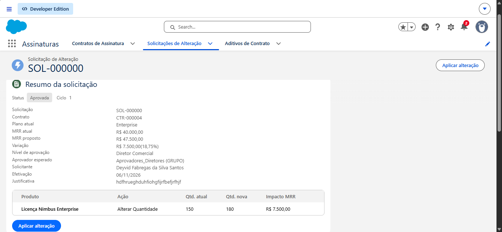

# Nimbus — Gestão de Assinaturas e Alteração de Planos

Projeto Salesforce em Apex e Flow para simulação, solicitação, aprovação por alçada e aplicação de alterações em contratos de assinatura.

> **Status (06/11/2026):** implantado na org `nimbus-org` e **jornada completa validada manualmente** (simular → enviar → decidir com segundo usuário → aplicar), com capturas em [docs/evidencias/jornada-validada.md](docs/evidencias/jornada-validada.md). Testes Apex: 77 aprovados, 0 falhas, cobertura da execução 92%, **meta de 90% por classe atingida em 52 de 64 classes** (faltam 12). Jest: 28 testes, 98,29%. Pendentes: 12 classes abaixo de 90%, Flow Tests, Code Analyzer e revisão de segurança completa. Veja [docs/CONTINUAR_DAQUI.md](docs/CONTINUAR_DAQUI.md) e [docs/STATUS.md](docs/STATUS.md).

## Estrutura

| Caminho                           | Conteúdo                                                                           |
|-----------------------------------|------------------------------------------------------------------------------------|
| `force-app/`                      | Apex, triggers, Flows e metadados de dados, configuração e permissões              |
| `force-app/main/default/flows/`   | Flow de roteamento (record-triggered) e Screen Flows de envio, decisão, reabertura e aplicação |
| `config/project-scratch-def.json` | Configuração de Scratch Org com Orders e quantidades negativas habilitados         |
| `scripts/apex/seed-catalog.apex`  | Carga opcional de demonstração (MRR inicial esperado de 2.700,00)                  |
| `scripts/apex/seed-contracts.apex`| Carga opcional de 6 contas e 6 contratos Ativos (idempotente)                      |
| `test/lwc/`                       | Testes Jest dos LWC                                                                |
| `docs/`                           | Arquitetura, modelo de dados, decisões, status e implantação                       |

## Jornada coberta

Simulação e rascunho (Apex) → envio (Screen Flow) → roteamento por alçada (Flow + Apex, Task ou aprovação automática) → decisão (Screen Flow + `SubscriptionDecisionService`) → reabertura ou aplicação transacional (Aditivo + Order, atômica e idempotente).

A tela de simulação (LWC), as Lightning Record Pages e o app `Assinaturas` já foram implantados (entrega 3D).

## Documentação

- [docs/STATUS.md](docs/STATUS.md): andamento, pendências e próximos passos
- [docs/IMPLANTACAO_NOVA_ORG.md](docs/IMPLANTACAO_NOVA_ORG.md): pré-requisitos e roteiro para uma org nova
- [docs/ARQUITETURA.md](docs/ARQUITETURA.md): camadas, responsabilidades e catálogo de componentes
- [docs/MODELO_DE_DADOS.md](docs/MODELO_DE_DADOS.md): objetos, Custom Metadata, Permission Sets e acessos a classes/Flows
- [docs/DECISOES_E_LIMITACOES.md](docs/DECISOES_E_LIMITACOES.md): decisões e limitações conhecidas
- [docs/CONTINUAR_DAQUI.md](docs/CONTINUAR_DAQUI.md): onde paramos e o que falta
- [docs/COMO_USAR_A_ORG.md](docs/COMO_USAR_A_ORG.md): usar a org, usuários de teste e passo a passo da jornada
- [docs/RESPOSTAS_CODE_REVIEW.md](docs/RESPOSTAS_CODE_REVIEW.md): respostas às 11 perguntas de code review do PDF
- [docs/evidencias/jornada-validada.md](docs/evidencias/jornada-validada.md): capturas da jornada completa na org
- [docs/O_QUE_FOI_ADICIONADO.md](docs/O_QUE_FOI_ADICIONADO.md): o que foi adicionado e para que serve
- [docs/SEGURANCA.md](docs/SEGURANCA.md): segurança da org (verificação parcial)
- [docs/RELATORIO_ERROS_PRE_DEPLOY.md](docs/RELATORIO_ERROS_PRE_DEPLOY.md): erros antes do deploy, correções e conformidade com o PDF
- [docs/evidencias/cobertura-apex.md](docs/evidencias/cobertura-apex.md): cobertura Apex por classe
- [docs/PARTE1 CODIGO APEX.md](docs/PARTE1%20CODIGO%20APEX.md): documentação da Parte 1

## Início

Use uma Scratch Org ou uma sandbox autorizada e siga [docs/IMPLANTACAO_NOVA_ORG.md](docs/IMPLANTACAO_NOVA_ORG.md). Não implante em produção enquanto os testes Apex obrigatórios e as validações pendentes não forem concluídos.
