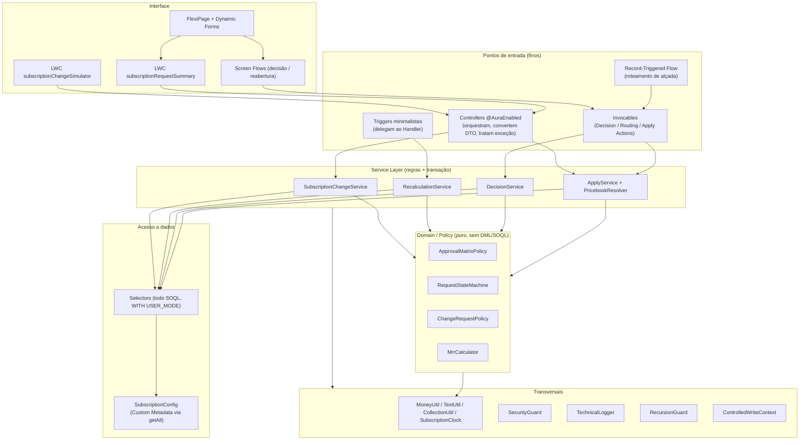
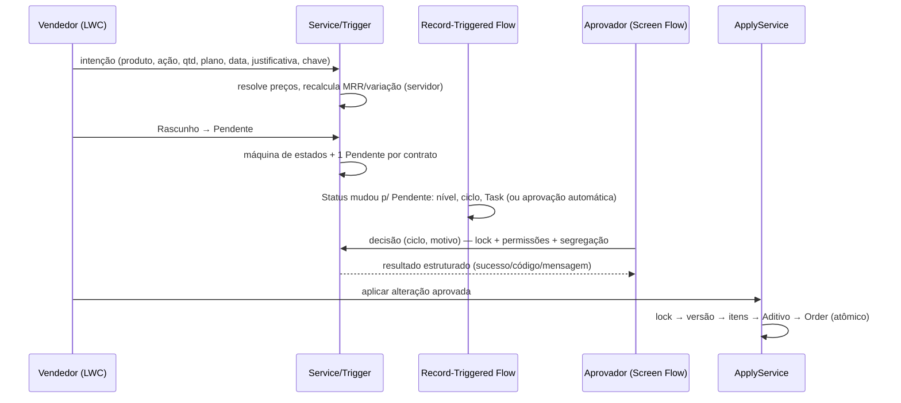

# ARQUITETURA — Desafio Nível 3: Gestão de Assinaturas e Alteração de Planos

> **Escopo desta versão (Partes 1 e 2):** arquitetura base, domínio/política, Selectors e utilitários (Parte 1); DTOs, Services, Handlers e Triggers de US-01/US-02 (Parte 2, ver seção 3).
> Invocables, Controllers, Flows e LWC chegam na Parte 3; os testes na Parte 4.
> As seções 5 e 6 já definem o contrato de dados e o ownership que as próximas partes vão respeitar.

---

## 1. Visão geral em camadas



**Regra de dependência:** a seta só aponta para baixo. Domain/Policy não conhece Selector, DML, UI nem Flow.
Controller nunca contém regra de negócio; Trigger nunca contém lógica; Flow nunca recalcula valores financeiros.

### Fluxo ponta a ponta (jornada do desafio)



---

## 2. Responsabilidades por componente

| Componente | Responsabilidade | Proibido |
|---|---|---|
| **LWC** (`subscriptionChangeSimulator`, `subscriptionRequestSummary`) | Coleta de intenção, prévia de MRR (conveniência), renderização condicional por estado/permissão | Calcular valor persistido, decidir segurança, enviar preço/nível/status como verdade |
| **Controller** (`@AuraEnabled`) | Orquestrar, converter DTO ↔ domínio, traduzir exceção em mensagem amigável (`TechnicalLogger.friendlyMessage`) | Regra de negócio, SOQL, DML direto |
| **Invocable / Action** | Adaptador para Flow: valida entrada, delega ao Service, devolve resultado estruturado | Regra de negócio própria |
| **Service** | Todas as regras de negócio e operações transacionais (Savepoint/rollback, locks, idempotência) | Montar SOQL, conhecer UI |
| **Selector** | **Todo** SOQL do projeto, `WITH USER_MODE`, bulk (`Set<Id>`), 1 consulta por lote | Regra de negócio, DML |
| **Domain/Policy** | Regras puras e determinísticas (matriz de alçada, máquina de estados, validações, cálculo de MRR) — testáveis sem DML | SOQL, DML, `UserInfo`, `Date.today()` direto (usa `SubscriptionClock`) |
| **Trigger** | Uma linha: delegar ao Handler | Qualquer lógica |
| **Handler** | Identifica registros afetados, chama Service/Policy, aplica `addError` por registro | DML fora do Service |
| **Record-Triggered Flow** | Roteamento: nível (via Invocable lendo metadado), ciclo, Task, aprovação automática, fault path | Recalcular MRR/variação (pertence à Trigger) |
| **Screen Flow** | Interface de decisão/reabertura; revalida tudo no Invocable | Ser a única barreira de segurança |
| **FlexiPage** | Composição por estado; visibilidade é UX | Substituir permissão ou validação no servidor |
| **Custom Metadata** | Matriz de alçada, limites, janela, Pricebook padrão, responsáveis | IDs ou dados transacionais |

---

## 3. Estrutura do repositório e catálogo de classes

```
force-app/main/default/
  classes/            (Apex)
  triggers/           (Parte 2)
  lwc/                (Partes 2 e 3)
  flows/              (Parte 3)
  flexipages/         (Parte 3)
  customMetadata/     (Parte 1b — modelo de dados)
  objects/            (Parte 1b — modelo de dados)
  permissionsets/ customPermissions/   (Parte 1b)
docs/                 (esta documentação)
```

### Entregue na Parte 1 (24 classes)

| Camada | Classe | Papel |
|---|---|---|
| Constantes | `SubscriptionConstants` | Valores de picklist, Custom Permissions e **códigos de erro estáveis** |
| Exceção | `SubscriptionException` | Erro de negócio: `code` estável + mensagem amigável |
| Utilitário | `MoneyUtil` | **Único** ponto de arredondamento (`Decimal`, 2 casas, `HALF_UP`) e de percentual |
| Utilitário | `TextUtil` | "Em branco" real (inclui NBSP/zero-width) e tamanho útil de texto |
| Utilitário | `CollectionUtil` | `pluckIds`, `pluckStrings`, `isNullOrEmpty` |
| Utilitário | `SubscriptionClock` | Relógio injetável (regras de data testáveis) |
| Segurança | `SecurityGuard` | CRUD, Custom Permission, `stripInaccessible` |
| Observabilidade | `TechnicalLogger` | `Log_Tecnico__c` que sobrevive ao rollback + mensagem amigável |
| Recursão | `RecursionGuard` | Controle por **conjunto de IDs + estado**, por escopo |
| Bypass | `ControlledWriteContext` | Escrita controlada em itens de contrato (escopo de transação e de contrato) |
| Configuração | `SubscriptionSettings`, `SubscriptionConfig` | Leitura única de Custom Metadata (`getAll()`, sem SOQL) |
| Domínio | `MrrCalculator` | MRR de item/contrato, variação absoluta e percentual |
| Domínio | `ApprovalMatrixPolicy` | Nível exigido (maior entre % e valor), piso de redução, teto, responsável |
| Domínio | `RequestStateMachine` | Transições válidas, estado inicial, editabilidade de itens |
| Domínio | `ChangeRequestPolicy` | Validações puras (contrato ativo, plano, data, duplicidade, quantidade, licenças, justificativa, motivo, versão) |
| Selector | `ContractSelector`, `ContractItemSelector`, `PlanSelector`, `RequestSelector`, `RequestItemSelector`, `DecisionHistorySelector`, `AdditiveSelector`, `PricebookSelector` | Todo o SOQL, `WITH USER_MODE`, `FOR UPDATE` onde exigido |

### Entregue na Parte 2 (US-01 e US-02)

| Camada | Classes / triggers |
|---|---|
| DTOs | `SubscriptionChangeRequestDTO` (intenção; campos “não confiáveis” ignorados), `SubscriptionChangeResultDTO` |
| Service | `SubscriptionChangeService` (simulate / saveDraft), `RequestItemService`, `RequestSnapshotService`, `RequestSubmissionService`, `RequestRecalculationService`, `ContractMrrService` |
| Domínio puro | `ChangeContext`, `ItemResolutionPolicy`, `ChangePlanner` |
| Dados em lote | `ChangeContextLoader`, `PricebookResolver` (antecipado da Parte 3: o preço de recursos adicionais vem dele) |
| Escrita em modo sistema | `CalculatedFieldWriter` (**único** `without sharing` da Parte 2; só campos calculados) |
| Handlers | `ItemAlteracaoHandler`, `SolicitacaoAlteracaoHandler`, `ItemContratoHandler` |
| Triggers | `SubscriptionItemChangeTrigger`, `SubscriptionRequestTrigger`, `SubscriptionContractItemTrigger` |
| Alterações em arquivos da Parte 1 | `SubscriptionConstants` (+12 códigos de erro), `PricebookSelector.selectActiveEntriesForPricebooks`, `RequestItemSelector.countByRequestIds` |

**Orçamento de consultas/DML (200 registros, medido por `Limits` na Parte 4)**

| Operação | SOQL | DML |
|---|---|---|
| Recalcular pais de 200 itens / 20 solicitações (`RequestRecalculationService`) — **US-02 CA01 (≤ 5 / ≤ 3)** | 2 | 1 |
| Resolução dos itens (before insert/update) | ≤ 7 | 0 |
| Snapshot de 200 solicitações (before insert) | 3 | 0 |
| Validação de envio de 200 solicitações (before update → Pendente) | ≤ 10 | 0 |
| `ContractMrrService` | 2 | ≤ 1 |

**Recursão (US-02):** `RecursionGuard` por **ID + fingerprint de estado** (`base|delta`) no recálculo; os Handlers só validam (sem DML), portanto a atualização de campos por Flow na mesma transação reexecuta a Trigger com `Status__c` inalterado e nada dispara ou bloqueia. Não há booleano estático global.

### Entregue na Parte 3 — Entrega 3A

| Camada | Classes |
|---|---|
| Autorização de status | `StatusTransitionContext`; `RequestStateMachine.requiresAuthorizedService` / `isCompensationTransition`; gate em `SolicitacaoAlteracaoHandler` |
| Roteamento (US-03) | `ApprovalRoutingService`, `ApprovalRoutingAction`, `ApprovalRoutingFaultAction` |
| Decisão (US-04) | `SubscriptionDecisionService` (bulk), `SubscriptionDecisionAction`, `SubscriptionReopenAction` |
| Dados/escrita | `DesignationSelector` (USER_MODE), `AuthorizedSystemWriter` (única escrita isolada junto com `CalculatedFieldWriter`) |
| Metadado | `Task.Chave_Deduplicacao__c`; `classAccesses` nos 3 Permission Sets |
| Arquivos existentes alterados | `SubscriptionConstants` (+constantes), `SubscriptionClock.now()`, `RequestStateMachine`, `SolicitacaoAlteracaoHandler` |

Orçamento (200 solicitações): roteamento ≤ 8 SOQL / 5 DML; decisão 5 SOQL / ≤ 4 DML.

### Entregue na Parte 3 — Entrega 3B (US-06)

| Camada | Classes |
|---|---|
| Service | `SubscriptionApplyService` (atômico, idempotente, lock Solicitação → Contrato) |
| Controller/DTO | `SubscriptionApplyController` (nunca lança), `SubscriptionApplyResultDTO` |
| Escrita isolada | `ContractApplyWriter` (itens, contrato, Aditivo, Order/OrderItem) |
| Alterados | `PricebookResolver.resolveEntries`, `SubscriptionConstants` (+3), Permission Sets (class access + leitura de Order/OrderItem), `project-scratch-def.json` (quantidade negativa) |

### Planejado (próximas partes)

| Parte | Entregas |
|---|---|
| 3 | Invocables (`ApprovalRoutingAction`, `SubscriptionDecisionAction`), `SubscriptionDecisionService`, `SubscriptionApplyService`, Controllers (devolvendo `SubscriptionChangeResultDTO.failure`, nunca lançando), Flows, FlexiPage, LWC; US-03 a US-06 |
| 4 | Testes Apex/Jest e demais documentos |

---|---|
| 2 | `SubscriptionItemChangeTrigger`, `SubscriptionRequestTrigger`, `SubscriptionContractItemTrigger` + Handlers; `RequestRecalculationService`; `SubscriptionChangeService`; DTOs; US-01/US-02 |
| 3 | Invocables (`ApprovalRoutingAction`, `SubscriptionDecisionAction`), `SubscriptionDecisionService`, `SubscriptionApplyService`, `PricebookResolver`, Controllers, Flows, FlexiPage, LWC; US-03 a US-06; `ROTEIRO_DEMO.md` |
| 4 | Testes Apex/Jest e demais documentos |

---

## 4. Estratégias transversais definidas na Parte 1

### 4.1 Dinheiro e arredondamento
- Somente `Decimal`; `MoneyUtil.round()` = `setScale(2, System.RoundingMode.HALF_UP)`. (Em Apex o método é de `Decimal`, não de `Math`.)
- **MRR do item** = `Quantidade × Preço` arredondado. **MRR do contrato** = soma dos MRR dos itens **ativos**.
- **Variação absoluta** = proposto − base (positivo = aumento).
- **Variação percentual** = `absoluta × 100 / base`, **um único arredondamento** no fim, em pontos percentuais (`18.00` = 18%), formato dos campos *Percent*.
- **Base = 0:** percentual **indefinido** → `null` (e `0.00` se a variação também for zero). A alçada usa então apenas o critério absoluto; o teto percentual não se aplica.
- Comparações de faixa usam o valor **já arredondado** (limites inclusivos).

### 4.2 Matriz de alçada (somente metadado)
- Regra: nível exigido = **maior** entre nível por % e nível por valor absoluto.
- Reduções: critério absoluto não existe (sem linhas no metadado) e há **piso Gerente de Contas** (nunca automáticas), garantido como invariante no domínio.
- Valor acima de todas as faixas limitadas → `BLOQUEADA` (falha segura). Teto de `Variacao_Maxima_Percentual__c` também bloqueia.
- Cada linha de `Matriz_Alcada__mdt` = (direção, critério, limite superior inclusivo ou faixa aberta, nível, responsável).

### 4.3 Recursão (`RecursionGuard`)
Booleano estático global é perigoso porque bloqueia operações legítimas na mesma transação (segundo lote, update de Flow, dados diferentes) e cria falsa sensação de proteção. Adotado: mapa `escopo → {Id → fingerprint}`; um registro só é barrado se **já está em processamento com o mesmo estado**. Estado diferente é reprocessamento legítimo; `exit()` em `finally` libera os IDs.

### 4.4 Escrita controlada em itens de contrato (`ControlledWriteContext`)
Bypass com **escopo de transação**, **escopo de contrato** (somente os IDs abertos), **justificativa obrigatória** e fechamento em `finally`. Apex não possui *friend class*; a restrição ao `SubscriptionApplyService` é por convenção + code review + regra de análise estática que reprova `open()` fora dele e das classes de teste.

### 4.5 Log técnico que sobrevive ao rollback (`TechnicalLogger`)
O log é inserido **após** `Database.rollback(savepoint)`, e a exceção é **tratada** (nunca propagada) para a transação ser confirmada. É o único DML em modo sistema da Parte 1 — justificado porque o usuário que sofreu a falha pode não ter *create* em `Log_Tecnico__c` e a falha não pode se perder por falta de permissão; nunca grava dado de negócio e nunca lança exceção.

### 4.6 Segurança
- `with sharing` em todas as classes. Nenhum `without sharing` na Parte 1.
- Selectors: `WITH USER_MODE` (sharing + CRUD + FLS). DMLs de negócio (próximas partes): `AccessLevel.USER_MODE`.
- Custom Permissions avaliadas via `FeatureManagement.checkPermission` (usuário em execução).

### 4.7 Locks
Consultas `FOR UPDATE` não aceitam `ORDER BY` e retornam só campos do próprio objeto. Ordem de lock fixa do módulo: **Solicitação → Contrato**, para evitar deadlock.

---

## 5. Modelo de dados (contrato que o código já referencia)

Nomes de API exatamente como o desafio os define; abaixo, apenas os **campos auxiliares** (permitidos pela especificação, a documentar no README).

### 5.1 `Log_Tecnico__c` (campos auxiliares usados pelo `TechnicalLogger`)

| Campo | Tipo |
|---|---|
| `Classe__c`, `Metodo__c`, `Tipo_Excecao__c` | Text(255) |
| `Registro_Relacionado__c` | Text(18) |
| `Mensagem__c`, `Stack_Trace__c` | Long Text Area |
| `Usuario__c` | Lookup(User) |
| `Data_Hora__c` | DateTime |

### 5.2 `Parametro_Assinatura__mdt` (um único registro com `Ativo__c = true`)

| Campo | Tipo | Uso |
|---|---|---|
| `Ativo__c` | Checkbox | Exatamente 1 registro ativo |
| `Variacao_Maxima_Percentual__c` | Number(5,2) | Teto de variação (módulo) |
| `Janela_Efetivacao_Dias__c` | Number(3,0) | Janela da data de efetivação |
| `Tamanho_Minimo_Justificativa__c` | Number(3,0) | Justificativa do solicitante |
| `Tamanho_Minimo_Motivo_Rejeicao__c` | Number(3,0) | Motivo de rejeição |
| `Pricebook_Padrao_Nome__c` | Text(80) | Fallback quando o contrato não tem `Pricebook__c` |

### 5.3 `Matriz_Alcada__mdt` (uma linha por direção × critério × faixa)

| Campo | Tipo | Valores / uso |
|---|---|---|
| `Ativo__c` | Checkbox | |
| `Direcao__c` | Picklist | `AUMENTO`, `REDUCAO` |
| `Criterio__c` | Picklist | `PERCENTUAL`, `ABSOLUTO` |
| `Limite_Superior__c` | Number(18,2) | Inclusivo; **vazio = faixa aberta** |
| `Nivel__c` | Picklist | `AUTOMATICA`, `GERENTE`, `DIRETOR`, `FINANCEIRO`, `BLOQUEADA` |
| `Responsavel_Tipo__c` | Picklist | `GRUPO`, `FILA`, `PAPEL` |
| `Responsavel_Nome__c` | Text | `DeveloperName` do grupo/fila/papel |

Carga inicial da matriz do desafio (13 linhas):

| Direção | Critério | Limites superiores → Nível |
|---|---|---|
| AUMENTO | PERCENTUAL | 5 → AUTOMATICA · 15 → GERENTE · 30 → DIRETOR · 50 → FINANCEIRO · *aberta* → BLOQUEADA |
| AUMENTO | ABSOLUTO | 2000 → AUTOMATICA · 10000 → GERENTE · 30000 → DIRETOR · 100000 → FINANCEIRO · *aberta* → BLOQUEADA |
| REDUCAO | PERCENTUAL | 10 → GERENTE · 25 → DIRETOR · *aberta* → FINANCEIRO |

### 5.4 Custom Permissions e Permission Sets
`Aprovar_Gerente`, `Aprovar_Diretor`, `Aprovar_Financeiro`, `Aplicar_Alteracao`; Permission Sets `Assinatura_Vendedor`, `Assinatura_Aprovador`, `Assinatura_Administrador`.

---

## 6. Documento de Ownership de Campos

Princípio: **cada campo tem um único escritor**. Trigger, Flow e Policy **validam** sem escrever o que não é seu. Onde mais de um componente toca o mesmo campo, a coordenação está explícita na coluna *Coordenação*.

### 6.1 `Contrato_Assinatura__c`

| Campo | Lê | Escreve | Coordenação |
|---|---|---|---|
| `Account__c`, `Periodicidade__c`, `Data_Inicio__c`, `Data_Fim__c`, `Pricebook__c`, `Gerente_Conta__c`, `Status__c` | Todos | Usuário/Admin (cadastro) | Fora do fluxo de alteração |
| `Plano_Atual__c` | Simulador, Apply | **ApplyService** | Somente dentro do lock da aplicação |
| `Versao__c` | Simulador (snapshot), Apply | **ApplyService** | +1 por aditivo; base do controle otimista |
| `MRR_Atual__c` | Todos | **Trigger `SubscriptionContractItemTrigger`** (via Service) | O ApplyService **não** escreve; a Trigger recalcula ao mudar os itens |

### 6.2 `Item_Contrato__c`

| Campo | Lê | Escreve | Coordenação |
|---|---|---|---|
| `Contrato__c`, `Produto__c`, `Tipo__c`, `Quantidade__c`, `Preco_Unitario_Mensal__c`, `Status__c` | Todos | **ApplyService** | Trigger bloqueia qualquer outro canal (exceto `ControlledWriteContext` aberto para o contrato) |
| `MRR_Item__c` | Todos | **Trigger (before)** | Quantidade × preço; nunca informado externamente |

### 6.3 `Solicitacao_Alteracao__c`

| Campo | Lê | Escreve | Coordenação |
|---|---|---|---|
| `Contrato__c`, `Tipo__c`, `Plano_Proposto__c`, `Data_Efetivacao__c`, `Justificativa__c`, `Chave_Idempotencia__c` | Todos | **SubscriptionChangeService** (intenção, DML em `USER_MODE`) | `Contrato__c` e `Chave_Idempotencia__c` imutáveis sempre; os demais só em Rascunho (+ `Justificativa__c`, livre) — `SolicitacaoAlteracaoHandler` |
| `MRR_Base__c`, `Versao_Contrato_Base__c` | Todos | **Trigger `SubscriptionRequestTrigger` (before insert, `RequestSnapshotService`)** — autoritativo, sobrescreve qualquer valor enviado | Imutáveis após a criação (**mudança da Parte 2**: antes era do Service; passou à Trigger para que um vendedor via API não informe uma base menor e caia numa alçada inferior) |
| `MRR_Proposto__c`, `Variacao_Absoluta__c`, `Variacao_Percentual__c` | Todos, **Flow só lê** | **Trigger `SubscriptionItemChangeTrigger`** (via `RequestRecalculationService` → `CalculatedFieldWriter`); valores iniciais pela Trigger de insert | Escritor único; congelados fora de Rascunho; coerência com a soma dos itens reverificada no envio |
| `Status__c` | Todos | Por transição (abaixo) | **Validada sempre** pela Trigger `SubscriptionRequestTrigger` + `RequestStateMachine` |
| `Nivel_Aprovacao__c` | Todos | **Flow de roteamento** (via Invocable que lê a matriz) | |
| `Ciclo_Aprovacao__c` | Todos | **Flow de roteamento** (+1 a cada entrada em Pendente) | Escritor único |
| `Aprovador__c` | Todos | **SubscriptionDecisionService** | Usuário que decidiu; vazio na aprovação automática |
| `Data_Decisao__c`, `Motivo_Rejeicao__c` | Todos | **SubscriptionDecisionService** (`Data_Decisao__c` também pelo Flow na aprovação automática) | Exclusão mútua pelo estado: Flow só na rota `Automática`; Service recusa nível `Automática` |

**Escritor de `Status__c` por transição**

| Transição | Escritor |
|---|---|
| Rascunho → Pendente | Ação de envio (Service) |
| Pendente → Aprovada (automática) | Flow de roteamento |
| Pendente → Aprovada / Rejeitada | `SubscriptionDecisionService` |
| Pendente → Cancelada | Service (cancelamento) |
| Rejeitada → Rascunho | `SubscriptionDecisionService` (reabertura) |
| Aprovada → Aplicada / Expirada | `SubscriptionApplyService` |

### 6.4 `Item_Alteracao__c`

| Campo | Lê | Escreve | Coordenação |
|---|---|---|---|
| `Solicitacao__c`, `Item_Contrato__c`, `Produto__c`, `Acao__c`, `Quantidade_Nova__c` | Todos | **SubscriptionChangeService** (intenção do usuário) | Somente em Rascunho |
| `Quantidade_Atual__c`, `Preco_Unitario_Mensal__c` | Todos | **Trigger (before, `RequestItemService` + `ItemResolutionPolicy`)** — a partir do item do contrato, do preço-base do plano ou do `PricebookEntry` | Valor enviado pelo cliente é sobrescrito (CA02 da US-01) em qualquer canal |
| `Delta_MRR__c` | Todos | **Trigger (before)** | `(nova − atual) × preço`, via `MrrCalculator` |

### 6.5 Demais objetos

| Objeto.Campo | Escreve | Observação |
|---|---|---|
| `Historico_Decisao__c.*` | Flow (Aprovação Automática), `DecisionService` (Aprovada/Rejeitada/Reaberta), `ApplyService` (Expirada) | **Somente inserção**; imutabilidade garantida por Trigger e por Permission Set sem edit/delete |
| `Aditivo_Contrato__c.*` | **ApplyService** | `Chave_Unica__c = SolicitacaoId-Ciclo` (`AdditiveSelector.uniqueKey`) |
| `Order`, `OrderItem` | **ApplyService** | Pricebook via `PricebookResolver` |
| `Task` (roteamento) | **Flow de roteamento**; encerramento pelo `DecisionService` | Chave de deduplicação `Solicitação-Ciclo` (campo auxiliar, Parte 3) |
| `Log_Tecnico__c.*` | **TechnicalLogger** (e ação de fault path do Flow) | Somente inserção |
| `Plano_Assinatura__c`, CMDTs | Admin / deploy | Somente leitura para o código |

---

## 7. Premissas e decisões que dependem da sua confirmação

1. **Plano × MRR.** O desafio define MRR como soma dos itens ativos e exige `MRR_Atual__c = MRR proposto` após a aplicação. Por isso o **upgrade/downgrade de plano é materializado como linhas**: sai o item de licença do produto do plano antigo e entra o item do `Produto__c` do plano novo, ao `Preco_Base_Mensal__c` do plano (preço por licença), mantendo a quantidade sujeita aos limites do plano novo. Assim o `MrrCalculator` continua puro e a soma dos itens fecha com o proposto.
2. **`Aprovador__c`** guarda o **usuário que decidiu** (único escritor: `DecisionService`). O responsável *esperado* (grupo/fila/papel) vem do metadado e aparece na UI e na Task. Na aprovação automática o campo fica vazio e o histórico registra a decisão automática.
3. **Rascunho → Cancelada não é permitida** (o desafio lista apenas Pendente → Cancelada). Basta uma linha no mapa de `RequestStateMachine` se você quiser permitir.
4. **Solicitante** = `CreatedById` da solicitação (o Owner pode mudar).
5. **Base de MRR zero** deixa o percentual indefinido (seção 4.1).
6. **Modelo de dados (Parte 1b) — entregue.** Metadados em `force-app/main/default` (objetos, campos, validações, CMDTs com a carga da matriz, Custom Permissions, grupos e Permission Sets). Detalhes e matriz de acesso em `docs/MODELO_DE_DADOS.md`.

---

## 8. Limitações conhecidas desta parte

- Código **não compilado/implantado** no ambiente de geração; validar com `sfdx project deploy start` após o modelo de dados.
- Multi-moeda: `PricebookEntry` duplicado por moeda não é tratado (ver `PricebookSelector`).
- O bypass de escrita é restrito por convenção e análise estática, não por visibilidade da linguagem.
- Lock `FOR UPDATE` em lote é limitado pela ausência de `ORDER BY` (ordem de aquisição definida pela plataforma).
