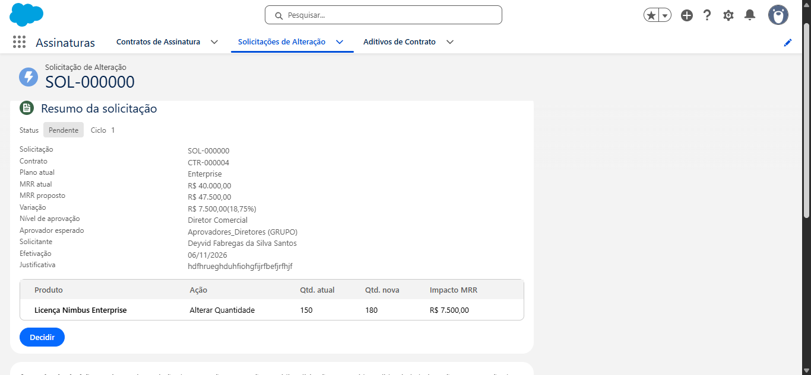
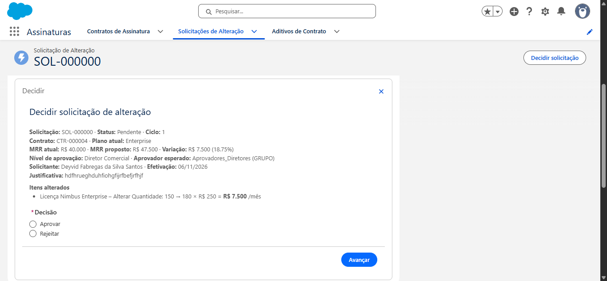
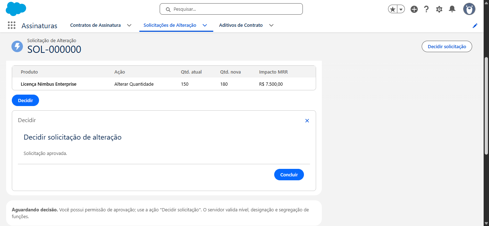
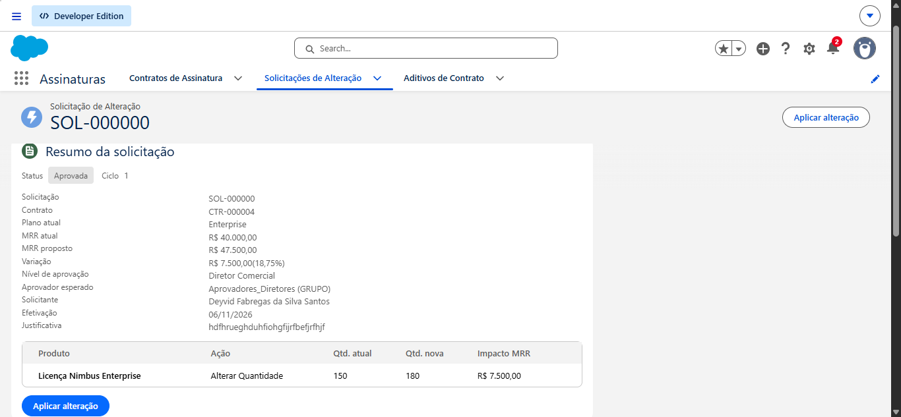
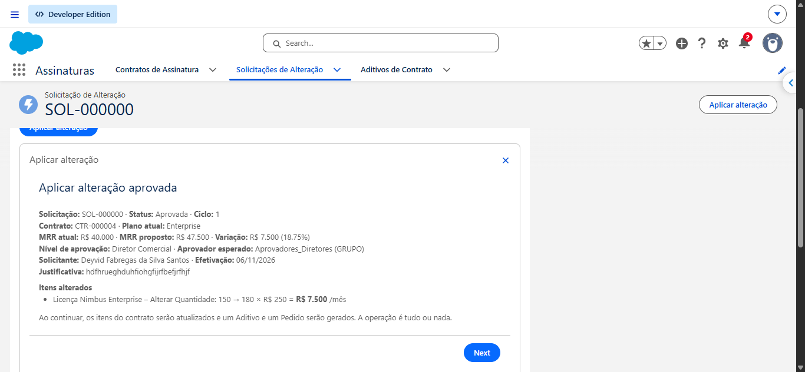
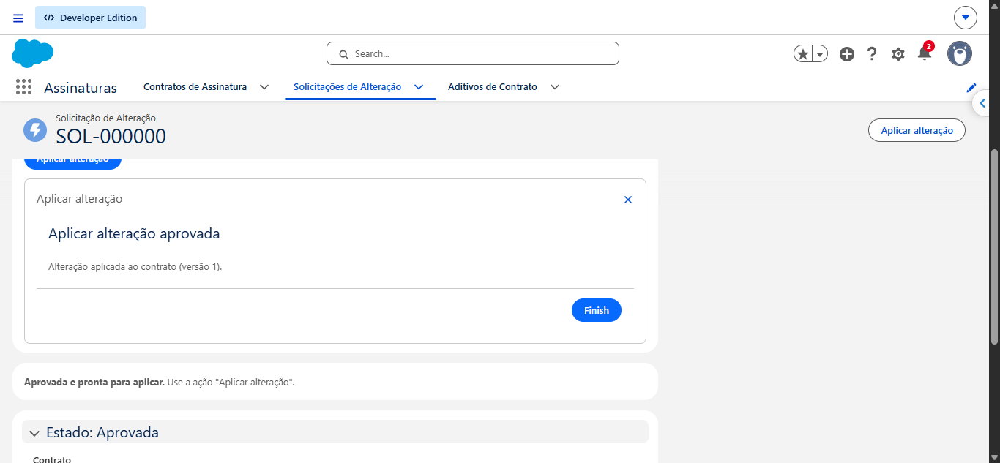
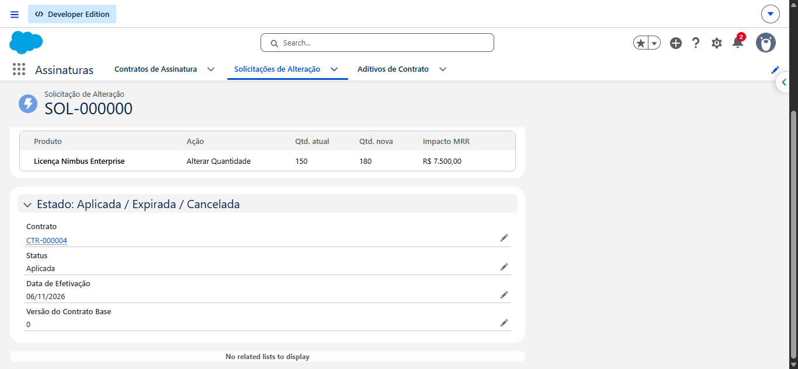
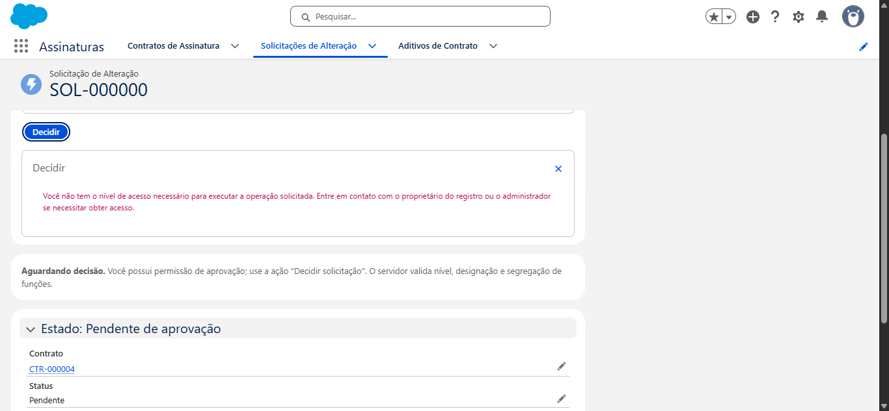

# Evidência: jornada completa validada na org

Validação manual em 06/11/2026 na org `nimbus-org`, com dois usuários, no app **Assinaturas**. Contrato: **CTR-000004** (Initech Sistemas, plano Enterprise, 150 licenças, MRR R$ 40.000). Solicitação: **SOL-000000** (150 → 180 licenças).

| Persona | Usuário | Permission Sets |
|---|---|---|
| Vendedor / administrador | `deyvidfabregas41@...` | `Assinatura_Administrador`, `Assinatura_Aprovador`, `Assinatura_Vendedor` |
| Aprovador | `aprovador.nimbus@...` | `Assinatura_Aprovador` (membro dos 3 grupos de aprovadores) |

## 1. Envio e roteamento

A solicitação foi simulada, salva como rascunho e enviada. O Flow de roteamento classificou a variação de R$ 7.500 (18,75%) como **Diretor Comercial**, aprovador esperado `Aprovadores_Diretores`, ciclo 1.

Para o solicitante, a tela informa "Quem criou a solicitação não pode decidi-la": é a segregação de funções validada no servidor.

## 2. Decisão pelo aprovador

O aprovador não vê a ação de aplicar ("Você não possui a permissão para aplicar alterações"), o que mantém as personas separadas.

## 3. Aplicação pelo vendedor

Resultado conferido na org: o item de licença passou a **180** (MRR do item R$ 45.000), o contrato ficou com **MRR R$ 47.500** e **versão 1**. A aplicação gera Aditivo e Order de forma atômica.

## Erro encontrado durante a validação

Antes da correção, o aprovador via esta mensagem ao clicar em **Decidir**:

Causa: nenhum Permission Set tinha a permissão de sistema **Executar fluxos** (`RunFlow`), necessária para abrir Screen Flows. Correção: `userPermissions` com `RunFlow` nos três Permission Sets. Detalhes em [../RELATORIO_ERROS_PRE_DEPLOY.md](../RELATORIO_ERROS_PRE_DEPLOY.md).

## Ainda sem captura

Simulador (limite do plano, bloqueio acima de 50%) e cenário de falha com rollback. O rollback é coberto por testes Apex (ver [cobertura-apex.md](cobertura-apex.md)).
